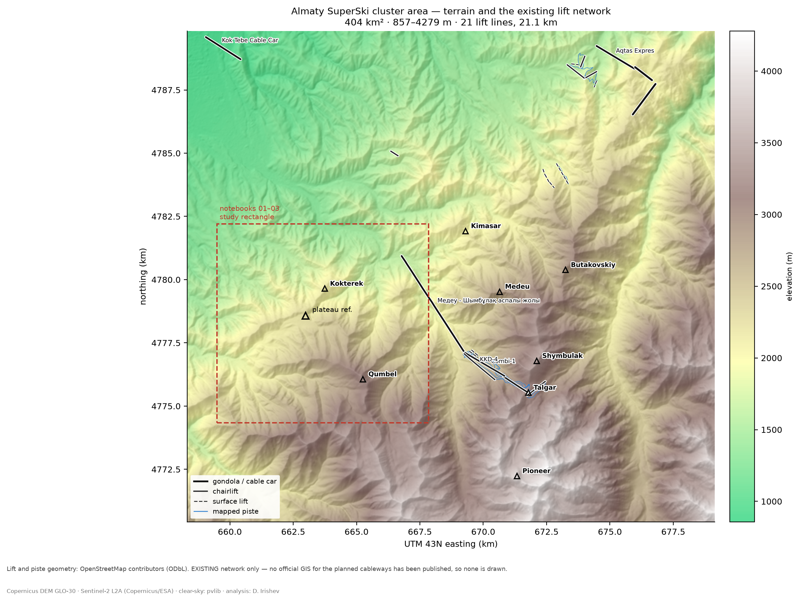

# Almaty SuperSki — ski terrain analytics

**An independent open-data case study of mountain terrain, sun exposure and snow
persistence above Almaty: the Kok Zhailau site and the cluster around it.**

Dias Irishev — Geo & Weather Data Scientist, Almaty · snowboarder
Release date: 19 November 2026

---

<table>
<tr>
<td width="50%"></td>
<td width="50%"></td>
</tr>
<tr>
<td><b>1,776 ha of operating area, read three ways.</b> Gradient against the BC resort classes, December hours of direct sun, March snow frequency over four seasons. The boundary is hand-drawn and <b>not official</b>; what it encloses is measured, not assumed.</td>
<td><b>404 km² of the cluster, with the lifts that exist today.</b> Every place the government statements name, plus Kok Zhailau and Kumbel. No planned alignment is drawn: none has been published.</td>
</tr>
</table>

**→ [4-slide demo for engineering and GIS teams (PDF)](almaty-superski-gis-demo.pdf)** · **[6-slide brief (PDF)](kok-zhailau-brief.pdf)**

---

## Five measured results across the cluster

**1. Exposure, not elevation, separates the snow.**
In the 2200–2300 m band on 15–35° slopes, north-facing terrain receives a median
**261.5 kWh/m²** of clear-sky insolation over March–April against **528.5 kWh/m²**
on south-facing terrain — a factor of **2.0**. Over the four-season spring window
those same north-facing slopes show snow on **93%** of usable satellite dates
against **40%** on south-facing slopes. Splitting by insolation quartile *within*
each 100 m band, so elevation is held fixed, the contrast in that band is
**93.3% vs 48.4%** (n = 1703 pixels per group; coverage 98% and 100%).

**2. Ten days of timing is worth more than a third of the spring snow signal.**
Re-cutting the four-season spring record against windows ten days earlier and ten
days later, compared on a fixed mask of **43.44 km²** observed in all three, the
median snow detection frequency moves **0.83 → 0.75 → 0.50**. A ±10-day shift in
timing is a **33-percentage-point** swing. Any plan with a date in it should be
stress-tested against that.

**3. December is a terrain-shading problem before it is a sun problem.**
On the median pixel, **70% of December daylight half-hours are terrain-shaded**,
against 28% in March. Median December clear-sky insolation is **21.6 kWh/m²**
against **143.0** in March — a factor of 6.6, far steeper than the change in day
length alone.

**4. Ranking terrain by solar *energy* and by *hours of sun* gives different answers.**
Over the 404 km² cluster area in November–April, the two rasters correlate at
only **r = 0.73**, and the top-10 skiable sites by each measure share **no points
at all**. Energy maxima sit on steep (≈34°) south faces near 4000 m; duration
maxima sit on gentler 15–20° south slopes that clear their horizon earlier. A
lift station and a solar array want different answers to "where is the sun".

**5. The window is four hours in December and nine in March.**
On the existing lift corridors, more than half the corridor is in direct sun for
**10:00–14:00 in December** (peaking at 69% sunlit) and **08:00–17:00 in March**
(100% at midday). The sun-and-snow screening index peaks in **February around
noon**, where 96% sunlit meets a 100% snow-detection frequency.

---

## What the operator has published, and what it has not

Almaty SuperSki **is** the Kok Zhailau project. Kazakh Tourism Development's
release from the board meeting of 18 November 2026, chaired by the Prime
Minister, gives **60 km of runs**, 11 cableways built by **POMA**, up to
**10,000 skiers a day**, a territory of **1,022 ha** with about 20 ha built on,
and a launch in **December 2028**. A statement of 24 April 2026 adds the places
the wider cluster touches: *Shymbulak*, the *Butakovka* and *Kimasar* gorges
(stage 1), *Pioneer* and *Oi-Qaragai* (stage 2, to be linked by cable car).

**Two published sources disagree, and this release carries both.** Sheet 3 of the
operator's own general plan states **16 lifts** and a four-way difficulty split —
**10.6 % green, 50.3 % blue, 22.7 % red, 16.4 % black**, so green and blue
together are **60.9 %** — and attaches its **70 %** figure to *snowmaking
coverage*. Press reporting of the April statement gave **17 lifts** and "about
70 % of runs green and blue". The 70 % appearing in both places, against
different quantities, is most likely a conflation. The general plan is the
operator's own drawing and gives a split rather than a round number, so it is the
default here; `config.py` holds both and every affected table is reported twice.

*(An earlier version of this file said Kok Zhailau was not named in the
statements, and used 17 lifts and 70 % green-and-blue throughout. Both are
corrected here and in METHODS §18 and §28.)*

What is still **not** published: any boundary, any lift alignment, any station
coordinate, any elevation, and any capacity in persons per hour.

## Fixing the study area, twice

The release originally analysed a 69 km² rectangle the author chose around the
plateau. Measured against the control points on the operator's general plan, that
rectangle was in the wrong place: **37 %** of it lay below 1,900 m — the elevation
of the base village, where nothing is planned — and **none** of it reached above
3,400 m, where the plan puts its top station. It ended 2.6 km north of the
Kumbeltau range and so excluded the entire high half of the project.

The general-plan sheet is a perspective panorama with no projection and no scale,
so **nothing is traced from it**. What it carries is named features. Seven of them
— Medeu, the Kokgailau plateau at 1,951 m, Three Brothers Rocks, Mountain Kumbel
at 3,250 m, the Kumbeltau range, Kimasar saddle and Shymbulak — were located
independently in OpenStreetMap, and the **125 km² `superski` compute rectangle**
is their envelope plus a 1.5 km working buffer. It holds **8,847 ha** in the
plan's 1,900–3,400 m operating band against 4,117 ha in the rectangle it replaced,
while adding almost no new ground below the village. ([extent review](docs/extent_review.png))

A rectangle is still a blunt instrument, so the **reporting** boundary is a
polygon: 24 vertices, hand-digitised over satellite imagery in Google Earth and
carried through `src/operating_area.py` as a mask. The rectangle stays the compute
grid; the polygon decides what every number below is quoted over. It encloses
**1,776 ha**, which is **174 %** of the operator's stated 1,022 ha — this is a
reading of the *operating area*, not of the land allocation, and it is **not an
official boundary**. Redraw it and `pipeline_operating_area.py` rewrites every
table and figure that depends on it.

## Inside the operating boundary

Reported against two same-area reconstructions of the same site, because a drawn
boundary is only worth having if it beats what a rule would pick: **A**, a disc of
the same area on the plateau, which uses no terrain information, and **B**, the
gentlest ground of the same area within 3.5 km, which is the most favourable
placement a planner could choose and therefore the right adversarial reference.

**6. Gentle ground is neither scarce nor confetti — if you choose where to put it.**
The boundary holds **364 ha** at green/blue gradients (20.5 % of it), and
**182 ha of that is one unbroken field** — half of all the gentle ground inside
it. The disc reaches 318 ha with its largest piece at 149 ha. Footprint B finds
**738 ha**, twice as much, but in **352 pieces** whose largest holds only
**28 %** — the slope-optimised placement is the worst of the three for a lift
network. Connectivity, not quantity, is what separates them.

**7. The published network of runs fits, with room.**
60 km of runs at the general plan's 60.9 % green and blue implies 110 ha of easy
piste at a 30 m mean width, 146 ha at 40 m, 183 ha at 50 m — **30 %, 40 % and
50 %** of the 364 ha available. On the press figure of 70 % it is 35 %, 46 % and
58 %. Earlier drafts put this at up to 101 % of available ground; that number came
from the superseded footprint and the conflated 70 %, and is withdrawn.

**8. The gentle ground is the sunny ground, which is not what the site average says.**
Median direct sun across the whole of December is **110 h** inside the boundary,
3.6 h a day, with the bottom tenth of pixels seeing **none at all**. On the
green/blue ground it is **168 h**, **5.4 h a day**. The plateau faces the city,
which is north — but the gentle shelves that would carry beginner runs are not the
north-facing part of it. Horizon sampled over 72 azimuths, duration stepped every
10 minutes.

**9. Vertical and altitude both came from drawing the boundary, not from the rule.**
The drawn site spans **1,775–3,291 m**, a vertical of **1,516 m**, against 1,432 m
for the disc; its median elevation is **2,568 m** against 2,118 m. The second
revision of the boundary added 479 ha entirely above 2,362 m, lifting the top from
3,225 m to 3,291 m.

## What survives being stress-tested

**10. Agreement between DEMs does not survive differentiation.**
The whole chain — slope, aspect, horizon, sky view factor, insolation, sunshine
duration — was rebuilt on NASADEM and ALOS AW3D30. Elevation correlates at
**0.9999**; slope, from those same pixels, at **0.836**. Median bias on December
insolation is **0.3 kWh/m²** at worst, but at the 95th percentile the December
figure moves by **50–66 %** of its own value. What survives is the ranking:
**85–95 %** of the top tenth of terrain is the same ground whichever DEM is used
(Spearman 0.955–0.977). Screen with it; do not sign off a single site on it.

**11. The December snow map describes the sunnier half of the site.**
A pixel needs four cloud- and shadow-free observations to enter a monthly map. In
December only **51.9 %** of the boundary qualifies, on a median of **5** valid
observations, and the qualifying pixels sit **+42.5 kWh/m²** sunnier and **4.0°
gentler** than the site as a whole. March is sound: **97.9 %** of the area
qualifies on a median of **24** observations, with a bias of +1.3 kWh/m² and
−0.2°, and a snow frequency of **1.00**. The bias is measured in
`operating_area_snow_by_month.csv`, not left to a caveat.

**12. Sun and snow rank the three places differently.**
One rule for all: an operating area is the ground within 150 m of a place's lifts
unioned with 100 m of its pistes — Shymbulak 7 lifts / 10.7 km (an independent
match to the "7 lines" in the April statement), Oi-Qaragai 8 lifts / 6.5 km.
Restricted to 15–35° and compared band by 200 m band against Kok Zhailau's own
best ground, Shymbulak's corridors take **−134 kWh/m²** of winter energy but hold
snow **+0.074** more often in March. Oi-Qaragai takes **+90 kWh/m²** and
**+0.182**, but sits under forest where NDSI is weakest, so it is the least
comparable number in the table.

---

## What this is, and what it is not

This is an independent study built from open data and own code. It is **not**
commissioned by, affiliated with, or endorsed by any resort operator, design office
or public body, and contains no commercial or NDA material.

Neither study area here is a project boundary. The 125 km² rectangle is derived
from control points on a published plan; the 1,776 ha polygon is hand-drawn over
imagery by the author. The operator states 1,022 ha and has published no
coordinates. Resort limits, lift alignments and designed pistes require official
GIS layers, and every figure caption says which boundary it was computed over.

A snow frequency here is *the share of usable satellite dates on which a pixel
looked like snow*. It is **not** ski days, **not** snow depth, and **not** a
snowmaking cost. `METHODS.md` §8 lists what this study cannot tell you and what
measurement would answer each question instead.

---

## Data actually processed

| | |
|---|---|
| Operating boundary | 24 vertices · **1,776 ha** · 1775–3291 m · hand-drawn, not official |
| SuperSki rectangle | 76.955–77.095° E, 43.078–43.172° N · **125 km²** · 1255–3893 m |
| Cluster rectangle | **404.12 km²**, 857–4279 m, 647 × 694 @ 30 m |
| Superseded rectangle | 76.960–77.065° E, 43.105–43.174° N · 69.12 km² · kept for provenance |
| Terrain | Copernicus DEM GLO-30, 2 tiles → 30 m grid, EPSG:32643 |
| Satellite | Sentinel-2 L2A, MGRS tile 43TFH, cloud < 15% |
| Scenes | **115** (114 historical + 1 current season), **0 download failures** |
| Unique dates | 112 after merging same-date scenes |
| Seasons | **4 complete**: 2022/23, 2023/24, 2024/25, 2025/26 (Nov–Apr) |
| Freshest scene | 2026-11-07 (`S2B_43TFH_20261107_0_L2A`), 33% usable pixels, 25% of those snow |
| Weather context | ERA5-Land (temperature, ≈9 km) and ERA5 (precipitation, ≈31 km) |
| Seasonal outlooks | Kazhydromet winter 2026/27 (issued 16 Nov 2026) and C3S November 2026 issue |
| Cross-checks | **77 Landsat 8/9** scenes · **NASADEM** and **ALOS AW3D30** · **MODIS** daily snow |
| Reference vectors | OpenStreetMap: 21 lift lines (21.1 km), 32 pistes (24.4 km), 23 stations |
| Data sources | **12 catalogued, 7 used**, each with endpoint and access cost |

Per-season scene counts: 30 / 28 / 25 / 31. The 2026/27 season is in progress and
is kept out of every historical comparison; `outputs/tables/current_season_gap.json`
records what is still to come so a later run can resume incrementally.

The SuperSki grid reuses the cluster's Sentinel-2 cache rather than re-downloading
it: both 20 m grids are snapped to the same multiples of 20 m in EPSG:32643, so the
115 scene windows are **sliced, not resampled**. One scene re-read from the COGs
matched the sliced arrays on **0 differing pixels out of 104,895**.

---

## What is in the release

```
README.md                  this file
METHODS.md                 sources, formulas, masks, thresholds, validation, limits
kok-zhailau-brief.pdf      6-slide brief
almaty-superski-gis-demo.pdf  4-slide demo: operating area, validation, handover
notebooks/                 01 terrain & insolation · 02 snow · 03 planning & 2027
                           04 cluster: lifts, radiation hours, timing, cross-checks
                           05 project scale, three-area comparison, DEM validation
src/                       the analysis library the notebooks call
  operating_area.py          reads the boundary, masks any grid, carries provenance
  pipeline_operating_area.py one command to rebuild everything the boundary decides
qgis/                      layer pack to redraw the boundary: hillshade, slope,
                           control points, OSM lifts, and a one-paste QGIS loader
outputs/geotiff/           47 GeoTIFFs + metadata JSON          (superseded 69 km²)
outputs/cluster/           24 GeoTIFFs, 9 figures, 15 tables    (cluster 404 km²)
outputs/kz_project/        11 GeoTIFFs, 3 figures, 20 tables    (project window 42 km²)
outputs/superski/          1 figure, 8 tables                   (operating boundary)
outputs/png/               15 maps and charts
outputs/tables/            20 CSVs
docs/                      the extent review, and the published outlooks with URLs
requirements.txt           pinned environment
run_all.sh                 end-to-end reproduction
```

Not committed, because the code regenerates them: the two Copernicus DEM tiles
(`data/raw`, ~70 MB), the cached terrain, insolation and sunshine arrays
(`data/interim`), and the Sentinel-2 scene-window cache, which is kept outside the
project folder so it can never be swept into a commit.

Key rasters: `elevation_m`, `slope_deg`, `aspect_deg`, `sky_view_factor`,
`insolation_{dec,mar,nov_dec,jan_feb,mar_apr}_kwh_m2` (+ direct-beam components),
`insolation_2027_{01..04,11,12}_kwh_m2`, `snow_frequency_{season}` and
`snow_frequency_4season`, `valid_observations_*`, `meltout_mid_day_*` with
`meltout_interval_width_days_*`, `field_priority_class`,
`slope_above_30deg`, `spring_2027_scenario_{earlier,analogue,later}`.

---

## Reproducing it

```bash
python3.12 -m venv .venv && source .venv/bin/activate
pip install -r requirements.txt
./run_all.sh
```

`run_all.sh` builds four study areas and executes the five notebooks in order.
Pick an area for any script with `KZ_AREA=` and one of `superski` (the operating
area), `cluster`, `kz_project` or `kok_zhailau`; each writes to its own output
subtree, so they never collide. Order matters once: `cluster` must be built before
`superski` and `kz_project`, which slice its scene cache instead of downloading
again. The first run fetches two DEM tiles (~70 MB) and the windows of 115
Sentinel-2 scenes; a cold run is roughly 45 minutes on a laptop, dominated by the
horizon ray-marches, the downloads and the sunshine-hour integration.

To change only the boundary, redraw `qgis/operating_area.geojson` and run:

```bash
KZ_AREA=superski python src/pipeline_operating_area.py
```

Override the cache location with `KZ_SCENE_CACHE=/path/to/cache`.

---

## Cross-validation

Nothing here rests on a single sensor.

| Check | Result |
|---|---|
| Copernicus GLO-30 vs **NASADEM** | median Δ −0.09 m, σ 7.40 m, r = 0.99995 |
| Copernicus GLO-30 vs **ALOS AW3D30** | median Δ +1.59 m, σ 7.15 m, r = 0.99996 |
| Sentinel-2 vs **Landsat 8/9**, same date, same pixels | r = **0.969**, agreement **86.8%**, 8.5 M pixels |
| Our NDSI rule vs the **USGS QA snow flag** | r = 0.879 over 77 Landsat scenes |
| Our NDSI rule vs the **Sen2Cor SCL snow class** | r = 0.973 over 115 Sentinel-2 scenes |
| **MODIS** daily cover, Feb–Apr 2023 | adds 36 days where Sentinel-2 has no usable scene |
| Sliced vs re-read Sentinel-2 window | **0 differing pixels of 104,895**, both planes |

Chasing the Landsat comparison also found a real bug: windowed reads computed
the window in the target CRS against the source transform, which is correct only
when the two match. MODIS is sinusoidal and returned zero snow everywhere.
`METHODS.md` §16 has the detail and the fix.

## Where it could go next

A two-week field pilot would test these results against ground measurement: align
official corridors and constraints with these layers, stake paired plots on
opposite exposures inside the same elevation band, measure snow depth and
irradiance, and hand back GeoTIFFs plus a discrepancy log naming every
disagreement and its likely cause. Notebook 03 §6 sets out the schedule. Beyond
that: a drone DEM over the corridors that matter, local wind modelling for snow
transport, and skier-flow modelling once designed geometry exists.

---

## Contact

Dias Irishev — Geo & Weather Data Scientist, Almaty
Econometrics and Operations Research, Erasmus University Rotterdam.
Solar exposure and multispectral analysis at SeeTree; weather forecasting and
aerial-imagery computer vision at MarineTech. Co-author,
*Frontiers in Marine Science*, [doi:10.3389/fmars.2024.1456480](https://doi.org/10.3389/fmars.2024.1456480).

---

*Contains modified Copernicus Sentinel data 2022–2026, processed by ESA · Copernicus
DEM GLO-30 © DLR/Airbus · Copernicus Climate Change Service information 2026 ·
OpenStreetMap © contributors, ODbL · clear-sky model: pvlib. Full attribution in
`METHODS.md` §10 and §17.*
