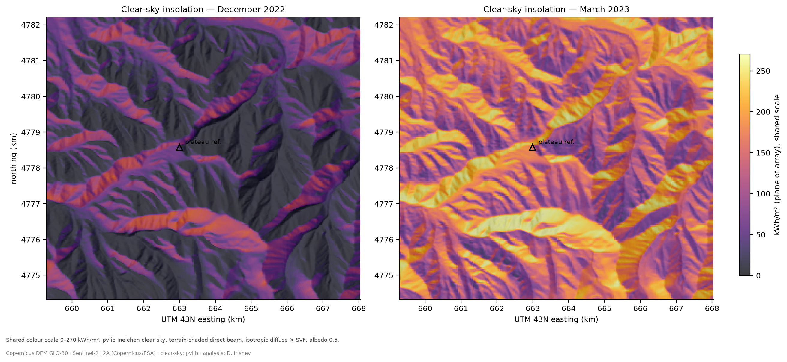

# Kok Zhailau ski terrain analytics

**An independent open-data case study of mountain terrain, sun exposure and snow
persistence above Almaty.**

Dias Irishev — Geo & Weather Data Scientist, Almaty · snowboarder
Release date: 19 November 2026

---

<table>
<tr>
<td width="50%"></td>
<td width="50%"></td>
</tr>
<tr>
<td><b>404 km² of the cluster area, with the lifts that exist today.</b> Every place the government statements name, plus Kok Zhailau and Kumbel. No planned alignment is drawn: none has been published.</td>
<td><b>Terrain decides the winter sun.</b> December and March clear-sky insolation on one shared scale: the December range is a thin slice of the March range.</td>
</tr>
</table>

**→ [4-slide demo for engineering and GIS teams (PDF)](almaty-superski-gis-demo.pdf)** · **[6-slide brief (PDF)](kok-zhailau-brief.pdf)**

---

## Five measured results, at 69 km² and 404 km²

**1. Exposure, not elevation, separates the snow.**
In the 2200–2300 m band on 15–35° slopes, north-facing terrain receives a median
**261.5 kWh/m²** of clear-sky insolation over March–April against **528.5 kWh/m²**
on south-facing terrain — a factor of **2.0**. Over the four-season spring window
those same north-facing slopes show snow on **93%** of usable satellite dates
against **40%** on south-facing slopes. Splitting by insolation quartile *within*
each 100 m band, so elevation is held fixed, the contrast in that band is
**93.3% vs 48.4%** (n = 1703 pixels per group; coverage 98% and 100%).

**2. Ten days of timing is worth more than a third of the spring snow signal.**
Re-cutting the four-season spring record against windows ten days earlier and ten
days later, compared on a fixed mask of **43.44 km²** observed in all three, the
median snow detection frequency moves **0.83 → 0.75 → 0.50**. A ±10-day shift in
timing is a **33-percentage-point** swing. Any plan with a date in it should be
stress-tested against that.

**3. December is a terrain-shading problem before it is a sun problem.**
On the median pixel, **70% of December daylight half-hours are terrain-shaded**,
against 28% in March. Median December clear-sky insolation is **21.6 kWh/m²**
against **143.0** in March — a factor of 6.6, far steeper than the change in day
length alone.

**4. Ranking terrain by solar *energy* and by *hours of sun* gives different answers.**
Over the 404 km² cluster area in November–April, the two rasters correlate at
only **r = 0.73**, and the top-10 skiable sites by each measure share **no points
at all**. Energy maxima sit on steep (≈34°) south faces near 4000 m; duration
maxima sit on gentler 15–20° south slopes that clear their horizon earlier. A
lift station and a solar array want different answers to "where is the sun".

**5. The window is four hours in December and nine in March.**
On the existing lift corridors, more than half the corridor is in direct sun for
**10:00–14:00 in December** (peaking at 69% sunlit) and **08:00–17:00 in March**
(100% at midday). The sun-and-snow screening index peaks in **February around
noon**, where 96% sunlit meets a 100% snow-detection frequency.

---

## The cluster area, and the limits of saying where it is

Almaty SuperSki **is** the Kok Zhailau project. Kazakh Tourism Development's
release from the board meeting of 18 November 2026, chaired by the Prime
Minister, gives **60 km of runs and 17 lifts on Kok Zhailau**, 11 of the
cableways built by POMA, **about 70 % of runs green and blue**, up to **10,000
skiers a day**, a territory of **1,022 ha** with about 20 ha built on, and a
launch in **December 2028**. A statement of 24 April 2026 adds the places the
wider cluster touches: *Shymbulak*, the *Butakovka* and *Kimasar* gorges
(stage 1), *Pioneer* and *Oi-Qaragai* (stage 2, to be linked by cable car).

*(An earlier version of this file said Kok Zhailau was not named in the
statements. That was true of the single April statement then on hand and wrong
about the record; it is corrected here and in METHODS §18.)*

What is still **not** published: any boundary, any lift alignment, any station
coordinate, any elevation, any capacity in persons per hour, and any breakdown
of the 60 km by difficulty.

The 404 km² rectangle analysed in notebook 04 is the smallest round bounding box
containing all of those places. It is **derived, not given**. The lift lines on
every map are the **existing** OpenStreetMap network — 21 lines, 21.1 km, plus
32 mapped pistes. **No planned alignment is drawn anywhere in this release,
because none has been published.**

## At project scale: 1,022 ha, and what survives being stress-tested

The operator states a territory of **1,022 ha** — 1/40 of the cluster — and no
boundary. So notebook 05 derives two footprints of exactly that area inside a
42 km² window and reports every number against both: **A**, the 1,022 ha nearest
the plateau reference point, which uses no terrain information; and **B**, the
gentlest 1,022 ha within 3 km, which is the most favourable ground a planner
could pick and therefore the right adversarial reference.

**6. The gentle ground exists. It is not in one place.**
Footprint A is one piece and **20.4 %** of it lies at green/blue gradients
(208 ha). Footprint B reaches **46.6 %** (476 ha) but arrives in **67 separate
pieces**, the largest 455 ha. Against a published 60 km of runs at about 70 %
green and blue, the implied green/blue area is 126 ha at a 30 m mean width,
168 ha at 40 m, 210 ha at 50 m — which on footprint A is 61 %, 81 % and **101 %**
of the gentle ground that exists there. The binding constraint is connectivity,
not quantity.

**7. Where the 1,022 ha is placed moves mid-winter sun by 3.9×.**
Median direct sun across the whole of December: **34.8 h** on footprint A, 1.1 h
a day, against **135.0 h** (4.4 h a day) on footprint B. The plateau faces the
city, which is north — good for holding snow, poor for December sun. Horizon
sampled over 72 azimuths, duration stepped every 5 minutes.

**8. Agreement between DEMs does not survive differentiation.**
The whole chain — slope, aspect, horizon, sky view factor, insolation, sunshine
duration — was rebuilt on NASADEM and ALOS AW3D30. Elevation correlates at
**0.9999**; slope, from those same pixels, at **0.836**. Median bias on December
insolation is **0.3 kWh/m²** at worst, but at the 95th percentile the December
figure moves by **50–66 %** of its own value. What survives is the ranking:
**85–95 %** of the top tenth of terrain is the same ground whichever DEM is used
(Spearman 0.955–0.977). Screen with it; do not sign off a single site on it.

**9. The December snow map describes the sunnier 43 % of the terrain.**
A pixel needs four cloud- and shadow-free observations to enter a monthly map.
In December only **43.2 %** of the window qualifies, with a median of **one**
valid observation, and the qualifying pixels sit **+285 kWh/m²** sunnier and
**4.5° gentler** than the terrain as a whole. February–April are sound
(83–98 % coverage). This was previously implicit; `snow.coverage_bias` now
measures it, and the caveat extends to the December and January entries of the
cluster sun-and-snow index.

**10. Sun and snow rank the three places differently.**
One rule for all: an operating area is the ground within 150 m of a place's
lifts unioned with 100 m of its pistes — Shymbulak 7 lifts / 10.7 km (an
independent match to the "7 lines" in the April statement), Oi-Qaragai 8 lifts /
6.5 km. Restricted to 15–35° and compared band by 200 m band against Kok
Zhailau's own best ground, Shymbulak's corridors take **−134 kWh/m²** of winter
energy but hold snow **+0.074** more often in March. Oi-Qaragai takes
**+90 kWh/m²** and **+0.182**, but sits under forest where NDSI is weakest, so
it is the least comparable number in the table. The earlier comparison against
the 2.2 and 1.0 km² OSM winter-sports polygons is superseded.

---

## What this is, and what it is not

This is an independent study built from open data and own code. It is **not**
commissioned by, affiliated with, or endorsed by any resort operator, design office
or public body, and contains no commercial or NDA material.

The official statement of 18 November 2026 on the Almaty SuperSki cluster
([primeminister.kz](https://primeminister.kz/en/news/construction-of-almaty-superski-cluster-is-in-active-phase-32133))
names no individual resort site. The rectangle analysed here is the author's own
choice of study area, **not a project boundary**. Resort limits, lift alignments and
designed pistes require official GIS layers.

A snow frequency here is *the share of usable satellite dates on which a pixel
looked like snow*. It is **not** ski days, **not** snow depth, and **not** a
snowmaking cost. `METHODS.md` §8 lists what this study cannot tell you and what
measurement would answer each question instead.

---

## Data actually processed

| | |
|---|---|
| Study rectangle | 76.960–77.065° E, 43.105–43.174° N · **69.12 km²** · 1271–3318 m |
| Terrain | Copernicus DEM GLO-30, 2 tiles → 30 m grid, EPSG:32643 |
| Satellite | Sentinel-2 L2A, MGRS tile 43TFH, cloud < 15% |
| Scenes | **115** (114 historical + 1 current season), **0 download failures** |
| Unique dates | 112 after merging same-date scenes |
| Seasons | **4 complete**: 2022/23, 2023/24, 2024/25, 2025/26 (Nov–Apr) |
| Coverage | 99.7% of pixels have ≥4 usable observations across the four seasons |
| Freshest scene | 2026-11-07 (`S2B_43TFH_20261107_0_L2A`), 33% usable pixels, 25% of those snow |
| Weather context | ERA5-Land (temperature, ≈9 km) and ERA5 (precipitation, ≈31 km) |
| Seasonal outlooks | Kazhydromet winter 2026/27 (issued 16 Nov 2026) and C3S November 2026 issue |
| Cluster area | 404.12 km², 857–4279 m, 647 × 694 @ 30 m |
| Cross-checks | **77 Landsat 8/9** scenes · **NASADEM** and **ALOS AW3D30** · **MODIS** daily snow |
| Reference vectors | OpenStreetMap: 21 lift lines (21.1 km), 32 pistes (24.4 km), 23 stations |
| Data sources | **12 catalogued, 7 used**, each with endpoint and access cost |

Per-season scene counts: 30 / 28 / 25 / 31. The 2026/27 season is in progress and
is kept out of every historical comparison; `outputs/tables/current_season_gap.json`
records what is still to come so a later run can resume incrementally.

---

## What is in the release

```
README.md                  this file
METHODS.md                 sources, formulas, masks, thresholds, validation, limits
OUTREACH.md                four short letters, one per audience
kok-zhailau-brief.pdf      6-slide brief
almaty-superski-gis-demo.pdf  4-slide demo: project scale, validation, handover
notebooks/                 01 terrain & insolation · 02 snow · 03 planning & 2027
                           04 cluster: lifts, radiation hours, timing, cross-checks
                           05 project scale, three-area comparison, DEM validation
src/                       the analysis library the notebooks call
outputs/geotiff/           47 GeoTIFFs + metadata JSON          (Kok Zhailau 69 km²)
outputs/cluster/           24 GeoTIFFs, 9 figures, 15 tables    (cluster 404 km²)
outputs/kz_project/        11 GeoTIFFs, 3 figures, 20 tables    (project scale 42 km²)
outputs/png/               14 maps and charts
outputs/tables/            20 CSVs, every number in this README
docs/seasonal_outlooks.json  the published outlooks, transcribed with URLs
data/interim/              scene list (STAC records) and the reanalysis series used
requirements.txt           pinned environment
run_all.sh                 end-to-end reproduction
```

Not in the archive, because the code regenerates them: the two Copernicus DEM tiles
(`data/raw`, ~70 MB), the cached terrain and insolation arrays (`data/interim/*.npz`),
and the Sentinel-2 scene-window cache (~2 MB, kept outside the release folder).

Key rasters: `elevation_m`, `slope_deg`, `aspect_deg`, `sky_view_factor`,
`insolation_{dec,mar,nov_dec,jan_feb,mar_apr}_kwh_m2` (+ direct-beam components),
`insolation_2027_{01..04,11,12}_kwh_m2`, `snow_frequency_{season}` and
`snow_frequency_4season`, `valid_observations_*`, `meltout_mid_day_*` with
`meltout_interval_width_days_*`, `field_priority_class`,
`slope_above_30deg`, `spring_2027_scenario_{earlier,analogue,later}`.

---

## Reproducing it

```bash
python3.12 -m venv .venv && source .venv/bin/activate
pip install -r requirements.txt
./run_all.sh
```

`run_all.sh` builds both study areas and executes the four notebooks in order.
Pick an area for any script with `KZ_AREA=kok_zhailau` or `KZ_AREA=cluster`
(the default); each writes to its own output subtree, so the two never collide. The first run downloads two DEM
tiles (~70 MB) and the AOI windows of 115 Sentinel-2 scenes; windows are cached
outside the release folder (`../kok-zhailau-scene-cache`, ~2 MB total) so a failed
run resumes rather than restarting. Terrain and insolation are cached in
`data/interim/`. A cold run takes roughly 35 minutes on a laptop, dominated by the two horizon
ray-marches, the Sentinel-2 and Landsat downloads, and the sunshine-hour
integration.

Override the cache location with `KZ_SCENE_CACHE=/path/to/cache`.

---

## Cross-validation

Nothing here rests on a single sensor.

| Check | Result |
|---|---|
| Copernicus GLO-30 vs **NASADEM** | median Δ −0.09 m, σ 7.40 m, r = 0.99995 |
| Copernicus GLO-30 vs **ALOS AW3D30** | median Δ +1.59 m, σ 7.15 m, r = 0.99996 |
| Sentinel-2 vs **Landsat 8/9**, same date, same pixels | r = **0.969**, agreement **86.8%**, 8.5 M pixels |
| Our NDSI rule vs the **USGS QA snow flag** | r = 0.879 over 77 Landsat scenes |
| Our NDSI rule vs the **Sen2Cor SCL snow class** | r = 0.973 over 115 Sentinel-2 scenes |
| **MODIS** daily cover, Feb–Apr 2023 | adds 36 days where Sentinel-2 has no usable scene |

Chasing the Landsat comparison also found a real bug: windowed reads computed
the window in the target CRS against the source transform, which is correct only
when the two match. MODIS is sinusoidal and returned zero snow everywhere.
`METHODS.md` §16 has the detail and the fix.

## Where it could go next

A two-week field pilot would test the three results above against ground
measurement: align official corridors and constraints with these layers, stake
paired plots on opposite exposures inside the same elevation band, measure snow
depth and irradiance, and hand back GeoTIFFs plus a discrepancy log naming every
disagreement and its likely cause. Notebook 03 §6 sets out the schedule. Beyond
that: a drone DEM over the corridors that matter, local wind modelling for snow
transport, and skier-flow modelling once designed geometry exists.

---

## Contact

Dias Irishev — Geo & Weather Data Scientist, Almaty
Econometrics and Operations Research, Erasmus University Rotterdam.
Solar exposure and multispectral analysis at SeeTree; weather forecasting and
aerial-imagery computer vision at MarineTech. Co-author,
*Frontiers in Marine Science*, [doi:10.3389/fmars.2024.1456480](https://doi.org/10.3389/fmars.2024.1456480).

---

*Contains modified Copernicus Sentinel data 2022–2026, processed by ESA · Copernicus
DEM GLO-30 © DLR/Airbus · Copernicus Climate Change Service information 2026 ·
clear-sky model: pvlib. Full attribution in `METHODS.md` §10.*
