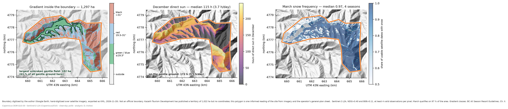

# Almaty SuperSki — ski terrain analytics

**An independent open-data case study of mountain terrain, sun exposure and snow
persistence above Almaty: the Kok Zhailau site and the cluster around it.**

Dias Irishev — Geo & Weather Data Scientist, Almaty · snowboarder
Release date: 24 November 2026

---

<table>
<tr>
<td width="50%"></td>
<td width="50%"></td>
</tr>
<tr>
<td><b>1,776 ha of operating area, read three ways.</b> Gradient against the BC resort classes, December hours of direct sun, March snow frequency over four seasons. The boundary is hand-drawn and <b>not official</b>; what it encloses is measured, not assumed.</td>
<td><b>404 km² of the cluster, with the lifts that exist today.</b> Every place the government statements name, plus Kok Zhailau and Kumbel. No planned alignment is drawn: none has been published.</td>
</tr>
</table>

**→ [4-slide demo for engineering and GIS teams (PDF)](almaty-superski-gis-demo.pdf)** · **[6-slide brief (PDF)](kok-zhailau-brief.pdf)**

### Four files, one job each

| | |
|---|---|
| **`README.md`** | this file. **The results** — every conclusion with the number behind it |
| **[`DATA.md`](DATA.md)** | **where every byte came from** — each dataset with its endpoint, resolution, epoch, projection, datum and licence, and the five sources costed and not used. The study area is its §10, deliberately last |
| **[`METHODS.md`](METHODS.md)** | **what is done with the data** — every formula, threshold, mask, validation and limit, in 21 sections |
| **[`ORIENTATION.md`](ORIENTATION.md)** | **the 30-minute route back in** — what is current, what was retracted, every assumption in one table, and what was never done |

First time here: the demo, then the findings below. Coming back after a break:
`ORIENTATION.md`. Deciding whether to trust a number: `METHODS.md` for how it
was computed, `DATA.md` for what it was computed from.

---

## Five measured results across the mountain

*How each was computed: `METHODS.md` §4 (insolation), §5 (sunshine duration),
§7 (joining terrain to snow), §12 (the sun-and-snow index), §13 (the 2027
windows). What each was computed from: `DATA.md` §3 and §4.*

**1. Exposure, not elevation, separates the snow.**
In the 2200–2300 m band on 15–35° slopes, north-facing terrain receives a median
**263.2 kWh/m²** of clear-sky insolation over March–April against **528.8 kWh/m²**
on south-facing terrain — a factor of **2.0**. Over the four-season spring window
those same north-facing slopes show snow on **87.5%** of usable satellite dates
against **32.5%** on south-facing slopes. Splitting by insolation quartile *within*
each 100 m band, so elevation is held fixed, the contrast in that band is
**85.7% vs 38.7%** (n = 1846 pixels per group; coverage 97% and 100%).

**2. Ten days of timing is worth more than a third of the spring snow signal.**
Re-cutting the four-season spring record against windows ten days earlier and ten
days later, compared on a fixed mask of **40.38 km²** observed in all three, the
median snow detection frequency moves **0.93 → 0.89 → 0.74**. A ±10-day shift in
timing is an **18-percentage-point** swing. Any plan with a date in it should be
stress-tested against that.

**3. December is a terrain-shading problem before it is a sun problem.**
On the median pixel, **63% of December daylight half-hours are terrain-shaded**,
against 27% in March. Median December clear-sky insolation is **31.1 kWh/m²**
against **157.3** in March — a factor of 5.1, far steeper than the change in day
length alone.

**4. Ranking terrain by solar *energy* and by *hours of sun* gives different answers.**
Over the 404 km² cluster area in November–April, the two rasters correlate at
only **r = 0.73**, and the top-10 skiable sites by each measure share **no points
at all**. Energy maxima sit on steep (≈34°) south faces near 4000 m; duration
maxima sit on gentler 15–20° south slopes that clear their horizon earlier. A
lift station and a solar array want different answers to "where is the sun".

**5. The window is four hours in December and nine in March.**
On the existing lift corridors, more than half the corridor is in direct sun for
**10:00–14:00 in December** (peaking at 69% sunlit) and **08:00–17:00 in March**
(100% at midday). The sun-and-snow screening index peaks in **February around
noon**, where 96% sunlit meets a 100% snow-detection frequency.

---

## What the operator has published, and what it has not

*Every published figure, transcribed with its source: `DATA.md` §7. The conflict
between two of them: `METHODS.md` §9.*

Almaty SuperSki **is** the Kok Zhailau project. Kazakh Tourism Development's
release from the board meeting of 18 November 2026, chaired by the Prime
Minister, gives **60 km of runs**, 11 cableways built by **POMA**, up to
**10,000 skiers a day**, a territory of **1,022 ha** with about 20 ha built on,
and a launch in **December 2028**. A statement of 24 April 2026 adds the places
the wider cluster touches: *Shymbulak*, the *Butakovka* and *Kimasar* gorges
(stage 1), *Pioneer* and *Oi-Qaragai* (stage 2, to be linked by cable car).

**Two published sources disagree, and this release carries both.** Sheet 3 of the
operator's own general plan states **16 lifts** and a four-way difficulty split —
**10.6 % green, 50.3 % blue, 22.7 % red, 16.4 % black**, so green and blue
together are **60.9 %** — and attaches its **70 %** figure to *snowmaking
coverage*. Press reporting of the April statement gave **17 lifts** and "about
70 % of runs green and blue". The 70 % appearing in both places, against
different quantities, is most likely a conflation. The general plan is the
operator's own drawing and gives a split rather than a round number, so it is the
default here; `config.py` holds both and every affected table is reported twice.

*(An earlier version of this file said Kok Zhailau was not named in the
statements, and used 17 lifts and 70 % green-and-blue throughout. Both are
corrected here and in `METHODS.md` §9.)*

What is still **not** published: any boundary, any lift alignment, any station
coordinate, any elevation, and any capacity in persons per hour.

## Fixing the study area, twice

*The geometry, the grids and the contract that enforces them: `METHODS.md` §2.
The same boundary described as data: `DATA.md` §10. The evidence that moved it:
notebook 06 §1.*

The study area is a polygon of **24 vertices**, hand-digitised over satellite
imagery in Google Earth and held in one file, `qgis/operating_area.geojson`.
Everything in this release is read inside it. It encloses **1,776 ha**, which is
**174 %** of the operator's stated 1,022 ha — a reading of the *operating area*,
not of the land allocation — and it is **not an official boundary**. Redraw it and
`pipeline_operating_area.py` rewrites every table and figure that depends on it.

Getting to one polygon took two retractions, and both are kept on the record.

1. The first release picked a **69 km² rectangle** around the plateau by
   assertion. Measured against the control points on the operator's general plan
   it was in the wrong place: it ended 2.6 km north of the Kumbeltau range,
   missed three of seven control points, held 38 % of its area below 1,900 m —
   the elevation of the base village — and reached nothing above 3,400 m, where
   the plan puts its top station.
2. The second derived a **125 km² rectangle** from those control points instead.
   Better placed, and still wrong for a different reason: the control points
   include Medeu and the Kimasar saddle down at the city edge, so the rectangle
   had to stretch about 3 km north of anywhere skiing is planned, over the dacha
   belt below 1,775 m. **Only 14 % of it was the site**, and every median it
   reported was a median over the other 86 %.

The general-plan sheet is a perspective panorama with no projection and no scale,
so **nothing is traced from it**; the seven features it labels — Medeu, the
Kokgailau plateau at 1,951 m, Three Brothers Rocks, Mountain Kumbel at 3,250 m,
the Kumbeltau range, Kimasar saddle and Shymbulak — were located independently in
OpenStreetMap. Notebook 06 §1 keeps that table, because it is the evidence that
moved the study area, not because either rectangle survived.

What remains is the polygon and a **70 km² working window** around it: the
polygon's own envelope plus the 1 km margin `operating_area.bbox()` returns,
which exists so hillshade has surroundings, the horizon has terrain to hit, and a
map has context around its subject. The polygon is 25 % of that window, and the
window is never a reporting unit. All three study areas and what each one
contains by elevation are drawn together in
[docs/extent_review.png](docs/extent_review.png), rebuilt by
`src/build_extent_review.py`.

## Inside the operating boundary

*`METHODS.md` §10, with the gradient classes and the piste arithmetic in §8.*

Earlier releases reported these numbers against two synthetic 1,022 ha footprints
— a disc on the plateau and the gentlest ground within 3.5 km. Neither was the
operating area, the disc sat over the dacha belt, and "gentlest ground" is by
construction the most flattering placement available. Both are **withdrawn**, and
`src/footprint.py` is deleted. There is a drawn boundary; nothing stands in for it.

**6. Gentle ground is neither scarce nor confetti.**
The boundary holds **364 ha** at green/blue gradients (20.5 % of it), scattered
over 133 fragments — but **182 ha of that is one unbroken field**, half of all the
gentle ground inside the boundary. Quantity is not the constraint here;
connectivity is, and connectivity is what a lift network consumes. What a 30 m DEM
cannot show is whether two separate benches can be joined by a lift.

**7. The published network of runs fits, with room.**
60 km of runs at the general plan's 60.9 % green and blue implies 110 ha of easy
piste at a 30 m mean width, 146 ha at 40 m, 183 ha at 50 m — **30 %, 40 % and
50 %** of the 364 ha available. On the press figure of 70 % it is 35 %, 46 % and
58 %. Earlier drafts put this at up to 101 % of available ground; that number came
from a synthetic footprint and the conflated 70 %, and both are withdrawn.

**8. The gentle ground is the sunny ground, which is not what the site average says.**
Median direct sun across the whole of December is **110 h** inside the boundary,
3.6 h a day, with the bottom tenth of pixels seeing **none at all**. On the
green/blue ground it is **168 h**, **5.4 h a day**. The plateau faces the city,
which is north — but the gentle shelves that would carry beginner runs are not the
north-facing part of it. Horizon sampled over 72 azimuths, duration stepped every
10 minutes.

**9. The site is one connected piece with 1,516 m of vertical.**
It spans **1,775–3,291 m** with a median elevation of **2,568 m**, and the
rasterised boundary is a single connected component — ample vertical for the
published 60 km of runs. The second revision of the boundary added 479 ha entirely
above 2,362 m, lifting the top from 3,225 m to 3,291 m.

## Will there be enough snow on the pistes?

*Added 25 November 2026. `METHODS.md` §22; sources in `DATA.md` §6.1. Snow
frequency says whether a pixel looked like snow on a date. It does not say
whether the ground that carries pistes holds snow long enough, without
breaking, or what can be made where it does not. These four findings are that
question.*

**13. The gentle ground holds its snow; the ground the runs descend does not.**
At the same 1,800–2,000 m, the gentle ground (35.5 ha, median slope 10.5°) was
snow-covered on **95 %** of usable March dates and held snow for an observed
**130 days**; the 15–35° ground beside it (67.4 ha, median slope 27.8°) managed
**42 %** and **99 days**. The gentle shelves there sit at 47.7 kWh/m² of
December sun against 78.7 on the steeper ground — at this elevation the gentle
ground is the *shaded* ground, which is the reverse of the site-wide pattern in
finding 8 and the reason it keeps its snow. The snowmaking case at the bottom of
this mountain is about the descent routes, not the beginner benches.

**14. The natural season is 93–167 days at the bottom and unmeasurable at the top.**
Across four seasons the beginner band's observed snow span ran 130, 135, 130 and
**93 days**. Adding the gaps in the satellite record either side, the shortest
season's upper bound (135) lands exactly on the longest season's lower bound
(135): 2025/26 was the shortest of the four, and **four seasons of optical
satellite cannot say by how much**. At and above 2,400 m the record mostly never
sees bare ground at all: averaged over the four seasons, **74–87 %** of pixels
have no bare-ground look before the first snow and **74–96 %** none after the
last, so the ~171 days those bands report is the 1 November – 30 April
observation window, not a measurement.

**15. The cover was never seen to break, and that says less than it sounds.**
Median breaks inside the span: **0**, continuity 0.97–1.00, every band, every
season. But with 15–25 usable looks spread over six months the median gap
between them is about twelve days, so no thaw shorter than that is visible. The
temperature record fills the hole the satellite leaves: inside the observed
season at 1,800–2,000 m, **57 % of days had a maximum above freezing**, 58–71
days froze and thawed on the same day, and **10.8 days a season brought rain on
snow**. The low ground keeps its cover by repeatedly passing through the melting
point, not by staying frozen.

**16. The weather allows the missing snow to be made, and the finding survives ±2 °C.**
At 1,900 m the four seasons gave a mean **270 hours below −4 °C wet bulb in
November** (171–305 across seasons) and **539 in December** (350–710); at the
−2 °C threshold the literature most often uses, 375 and 644. Temperature at band
elevation is extrapolated from a 2,235 m reanalysis cell at a standard
6.5 °C/km — the largest assumption in this section — so it is swept: even 2 °C
warmer than assumed, November still gives **171.5 hours**. Thaw counts are less
robust, moving by a factor of two over the same sweep, and are quoted with it.
None of this is a snowmaking budget: water, pumping and gun type are not
published.

## What survives being stress-tested

*`METHODS.md` §14 (does the DEM choice change the answer), §6 (the coverage
bias) and §11 (one comparison rule for three places).*

**10. Agreement between DEMs does not survive differentiation.**
The whole chain — slope, aspect, horizon, sky view factor, insolation, sunshine
duration — was rebuilt on NASADEM and ALOS AW3D30 over the 49,883 skiable pixels
of the window. Elevation correlates at **0.9999**; slope, from those same pixels,
at **0.827**. Median bias on December insolation is **0.2 kWh/m²** at worst, but
at the 95th percentile the December figure moves by **37–59 %** of its own value.
What survives is the ranking: **84–94 %** of the top tenth of terrain is the same
ground whichever DEM is used (Spearman 0.969–0.988). Screen with it; do not sign
off a single site on it.

**11. The December snow map describes the sunnier half of the site.**
A pixel needs four cloud- and shadow-free observations to enter a monthly map. In
December only **51.9 %** of the boundary qualifies, on a median of **5** valid
observations, and the qualifying pixels sit **+42.5 kWh/m²** sunnier and **4.0°
gentler** than the site as a whole. March is sound: **97.9 %** of the area
qualifies on a median of **24** observations, with a bias of +1.3 kWh/m² and
−0.2°, and a snow frequency of **1.00**. The bias is measured in
`operating_area_snow_by_month.csv`, not left to a caveat.

**12. Sun and snow rank the three places differently.**
One rule for all: an operating area is the ground within 150 m of a place's lifts
unioned with 100 m of its pistes — Shymbulak 7 lifts / 10.7 km (an independent
match to the "7 lines" in the April statement), Oi-Qaragai 8 lifts / 6.5 km.
Restricted to 15–35° and compared band by 200 m band against the drawn boundary
cut to the same gradients, Shymbulak's corridors take **−62 kWh/m²** of winter
energy and **−224 h** of direct sun over 8 shared bands, and hold snow
**+0.018** more often in March: they trade sun for snow, and over the whole
boundary rather than its best ground that trade is smaller than it looked.
Oi-Qaragai takes **+95 kWh/m²** and **+0.301**, but sits at 1,518–2,279 m under
forest where NDSI is weakest, so it is the least comparable number in the table.

---

## What this is, and what it is not

This is an independent study built from open data and own code. It is **not**
commissioned by, affiliated with, or endorsed by any resort operator, design office
or public body, and contains no commercial or NDA material.

No boundary here is a project boundary. The 1,776 ha polygon is hand-drawn over
imagery by the author; the 70 km² rectangle around it is a compute window, never a
reporting unit. The operator states 1,022 ha and has published no coordinates.
Resort limits, lift alignments and designed pistes require official GIS layers,
and every figure caption says which boundary it was computed over.

A snow frequency here is *the share of usable satellite dates on which a pixel
looked like snow*. It is **not** ski days, **not** snow depth, and **not** a
snowmaking cost. Findings 13–16 go as far as open data honestly reach — how long
the cover lasted, how often it was seen to break, how many hours the weather
allowed snow to be made — and `METHODS.md` §22.6 is explicit that none of that
is a depth, a water volume or a budget. `METHODS.md` §18 lists what this study
cannot tell you at all, and what measurement would answer each question instead.

---

## How much was processed

*How much ground and how many scenes. Where each dataset came from — endpoint,
resolution, epoch, projection, datum, licence — is [`DATA.md`](DATA.md) §1 to §6;
the five sources catalogued, costed and not used are its §8.*

| | |
|---|---|
| Operating boundary | 24 vertices · **1,776 ha** · 1775–3291 m · hand-drawn, not official · the study area |
| Working window | 76.950–77.055° E, 43.085–43.155° N · **70.17 km²** · 1382–3627 m · 292 × 267 @ 30 m |
| Cluster rectangle | **404.12 km²**, 857–4279 m, 647 × 694 @ 30 m |
| Retired rectangles | 69.12 km² (1st release) and 125.34 km² (2nd); no longer computed, see nb 06 §1 |
| Terrain | Copernicus DEM GLO-30, 2 tiles → one 30 m grid in EPSG:32643 |
| Sentinel-2 | **115 scenes** on MGRS tile 43TFH, cloud < 15%, 112 unique dates, **0 download failures** |
| Seasons | **4 complete**: 2022/23, 2023/24, 2024/25, 2025/26 (Nov–Apr) · 30 / 28 / 25 / 31 scenes |
| Freshest scene | 2026-11-07 (`S2B_43TFH_20261107_0_L2A`), 33% usable pixels, 25% of those snow |
| Cross-checks | **77 Landsat 8/9** scenes · **NASADEM** and **ALOS AW3D30** · **MODIS** 46 usable days |
| Reference vectors | OpenStreetMap: 21 lift lines (21.1 km), 32 pistes (24.4 km), 23 stations |
| Weather context | ERA5-Land and ERA5, daily **and hourly** (30,648 hours), 2022-11-01 → 2026-04-30 |
| Published outlooks | Kazhydromet winter 2026/27 and C3S November 2026 — transcribed, not modelled |
| Sources in all | **12 catalogued, 7 used** |

The 2026/27 season is in progress and is kept out of every historical comparison;
`outputs/superski/tables/current_season_gap.json` records what is still to come so
a later run can resume incrementally.

The working window reuses the cluster's Sentinel-2 cache rather than
re-downloading it: both 20 m grids are snapped to the same multiples of 20 m in
EPSG:32643, so the 115 scene windows are **sliced, not resampled**. One scene re-read from the COGs
matched the sliced arrays on **0 differing pixels out of 174,800**. How the cache
is keyed, and why it sits outside the project folder, is `DATA.md` §9.

---

## What is in the release

```
README.md                  this file: the results
DATA.md                    where every byte came from — dataset, endpoint,
                           resolution, epoch, projection, datum, licence, and the
                           five sources costed and not used. Study area in §10
METHODS.md                 what is done with it — formulas, masks, thresholds,
                           validation and limits, in 21 sections
ORIENTATION.md             the route back in: what is current, what was retracted,
                           every assumption in one table, and what was never done
LICENSE                    MIT for the code and figures; the data carry their own
                           terms, listed in DATA.md §12
kok-zhailau-brief.pdf      6-slide brief
almaty-superski-gis-demo.pdf  4-slide demo: operating area, validation, handover
notebooks/                 01 terrain & insolation · 02 snow · 03 planning & 2027
                           04 cluster: lifts, radiation hours, timing, cross-checks
                           05 project scale, three-area comparison, DEM validation
                           06 the operating boundary: why the area moved, and
                              what is inside it  <- start here
                           every notebook but 04 runs on the drawn boundary
                           and the 70 km² window around it
src/                       the analysis library the notebooks call, and the
                           entry points that write every output:
  operating_area.py          reads the boundary, masks any grid, carries provenance
  pipeline_terrain.py        terrain, horizon, sky view factor, insolation
  pipeline_snow.py           the Sentinel-2 snow record
  pipeline_sun.py            hours of direct sun
  slice_window_cache.py      hands the window the cluster's scenes, unresampled
  pipeline_operating_area.py one command to rebuild everything the boundary decides
  snow_sufficiency.py        season length, continuity, the snowmaking window
  pipeline_snow_sufficiency.py  is there enough snow on the pistes?
  build_qgis_pack.py         rebuilds qgis/ on the current analysis grid
  build_extent_review.py     all three study areas in one figure
  build_brief.py, build_demo.py   the two PDFs
qgis/                      layer pack to redraw the boundary: hillshade, slope,
                           control points, OSM lifts, and a one-paste QGIS loader
outputs/superski/          50 GeoTIFFs, 19 figures, 40 tables  (the study area:
                           notebooks 01-03, 05 and 06 write here)
outputs/cluster/           24 GeoTIFFs, 9 figures, 15 tables    (cluster 404 km²)
docs/                      the extent review, and the published outlooks with URLs
requirements.txt           pinned environment
run_all.sh                 end-to-end reproduction: two areas, eight steps
```

Nothing under `data/` is committed, and neither is the Sentinel-2 scene cache,
which sits outside the project folder so it can never be swept into a commit.
`run_all.sh` regenerates both; `DATA.md` §9 is the layout and the sizes.

Key rasters: `elevation_m`, `slope_deg`, `aspect_deg`, `sky_view_factor`,
`insolation_{dec,mar,nov_dec,jan_feb,mar_apr}_kwh_m2` (+ direct-beam components),
`insolation_2027_{01..04,11,12}_kwh_m2`, `snow_frequency_{season}` and
`snow_frequency_4season`, `valid_observations_*`, `meltout_mid_day_*` with
`meltout_interval_width_days_*`, `field_priority_class`,
`slope_above_30deg`, `spring_2027_scenario_{earlier,analogue,later}`.

---

## Reproducing it

```bash
python3.12 -m venv .venv && source .venv/bin/activate
pip install -r requirements.txt
./run_all.sh
```

`run_all.sh` builds two areas and executes the six notebooks in order. Pick an
area for any script with `KZ_AREA=` and one of `superski` (the drawn boundary and
its working window) or `cluster`; each writes to its own output subtree, so they
never collide. Order matters once: `cluster` must be built before `superski`,
which slices its scene cache instead of downloading again. The first run fetches two DEM tiles (~70 MB) and the windows of 115
Sentinel-2 scenes; a cold run is roughly 45 minutes on a laptop, dominated by the
horizon ray-marches, the downloads and the sunshine-hour integration.

To change only the boundary, redraw `qgis/operating_area.geojson` and run:

```bash
KZ_AREA=superski python src/pipeline_operating_area.py
```

Override the cache location with `KZ_SCENE_CACHE=/path/to/cache`.

---

## Cross-validation

*The sources: `DATA.md` §3.2 (the two other DEMs), §4.2 (Landsat), §4.3 (MODIS).
The method and the thresholds: `METHODS.md` §15.*

Nothing here rests on a single sensor.

| Check | Result |
|---|---|
| Copernicus GLO-30 vs **NASADEM** | median Δ +0.39 m, σ 6.61 m, r = 0.99992 |
| Copernicus GLO-30 vs **ALOS AW3D30** | median Δ +2.09 m, σ 5.05 m, r = 0.99995 |
| Sentinel-2 vs **Landsat 8/9**, same date, same pixels | r = **0.969**, agreement **86.8%**, 8.5 M pixels |
| Our NDSI rule vs the **USGS QA snow flag** | r = 0.879 over 77 Landsat scenes |
| Our NDSI rule vs the **Sen2Cor SCL snow class** | r = 0.973 over 115 Sentinel-2 scenes |
| **MODIS** daily cover, Feb–Apr 2023 | adds 36 days where Sentinel-2 has no usable scene |
| Sliced vs re-read Sentinel-2 window | **0 differing pixels of 174,800**, both planes |

Chasing the Landsat comparison also found a real bug: windowed reads computed
the window in the target CRS against the source transform, which is correct only
when the two match. MODIS is sinusoidal and returned zero snow everywhere.
`METHODS.md` §15 has the detail and the fix.

## Where it could go next

A two-week field pilot would test these results against ground measurement: align
official corridors and constraints with these layers, stake paired plots on
opposite exposures inside the same elevation band, measure snow depth and
irradiance, and hand back GeoTIFFs plus a discrepancy log naming every
disagreement and its likely cause. Notebook 03 §6 sets out the schedule. Beyond
that: a drone DEM over the corridors that matter, local wind modelling for snow
transport, and skier-flow modelling once designed geometry exists.

---

## Contact

Dias Irishev — Geo & Weather Data Scientist, Almaty
Econometrics and Operations Research, Erasmus University Rotterdam.
Solar exposure and multispectral analysis at SeeTree; weather forecasting and
aerial-imagery computer vision at MarineTech. Co-author,
*Frontiers in Marine Science*, [doi:10.3389/fmars.2024.1456480](https://doi.org/10.3389/fmars.2024.1456480).

---

*Contains modified Copernicus Sentinel data 2022–2026, processed by ESA · Copernicus
DEM GLO-30 © DLR/Airbus · Copernicus Climate Change Service information 2026 ·
OpenStreetMap © contributors, ODbL · clear-sky model: pvlib. Every source, endpoint
and licence is in [DATA.md](DATA.md) §12.*
